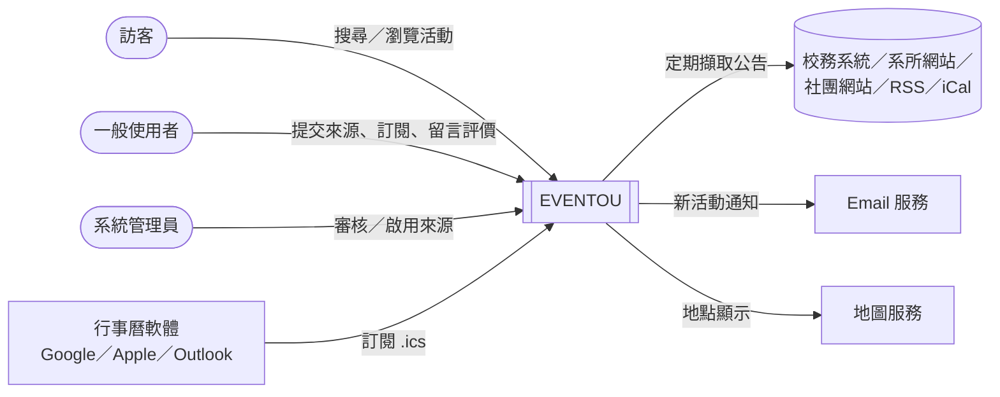
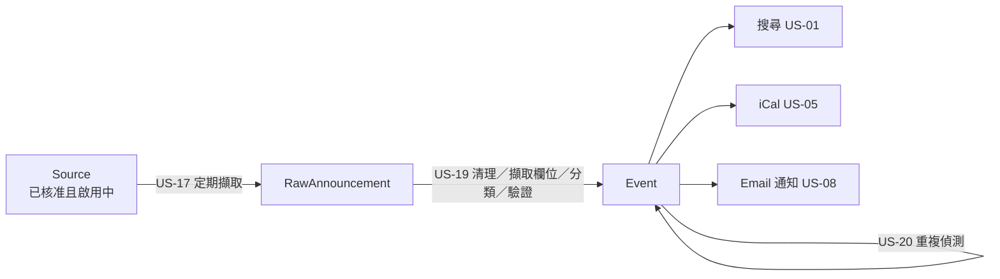

# 軟體需求文件(SRD)

---

## 專案資訊
- **專案名稱**：校園活動資訊聚合與訂閱系統 EVENTOU
- **撰寫日期**：2026/10/11
- **發展者**：（待補：專案成員名字）

---

## 版次變更記錄

| 版次 | 變更項目 | 變更日期 |
|------|----------|----------|
| 0.1  | 初版：依需求書與 GitHub Issues（US-01～US-20）撰寫 | 2026/10/11 |
| 0.3  |          |          |
| 0.4  |          |          |
| 0.5  |          |          |
| 0.6  |          |          |
| 1.0  |          |          |

---

## 目錄
1. [接受準則 (Acceptance Criteria)](#section1)
2. [系統概述 (System Description)](#section2)
3. [操作概念 (Operational Concepts)](#section3)
4. [使用者故事地圖 (User Story Map)](#section4)
5. [使用者介面分析 (User Interface Analysis)](#section5)
6. [功能需求 (Functional Requirements)](#section6)
7. [非功能需求 (Non-functional Requirements)](#section7)

---

## <span id="section1">接受準則 (Acceptance Criteria of this document)</span>
- Clearly and properly stated（需求需清楚且適當的陳述）
- Complete（需求需完整）
- Consistent with each other（需求之間需維持一致性）
- Uniquely identified（每項需求有明確之識別）
- Appropriate to implement（需求需可被實作）
- Verifiable（需求需可被驗證）

---

## <span id="section2">系統概述 (System Description)</span>

### 背景與目標
學校的活動與公告資訊非常分散：有些在校務系統，有些在各系所或處室網站，還有部分只發布在 Instagram 等社群平台。學生難以掌握所有資訊來源，也不可能每天逐一查看，因此常錯過實用的活動（例如免費餐券發放）。

EVENTOU 的目標是**自動蒐集並整理分散在各來源的校園活動資訊**，讓使用者只需訂閱感興趣的類別，有相關活動時就能透過 Email 或行事曆得知。

> 一句話目標：**下次學校再發免費餐券，我至少要知道。**

### 系統特色
1. **來源由社群提交、管理員把關**：一般使用者可提交新的資訊來源，管理員審核、啟用後才進入擷取流程。
2. **自動擷取與統一格式**：系統定期擷取已核准來源的公告，整理為統一格式的活動資料（Event），搜尋、行事曆、通知共用同一份資料。
3. **多種取得管道**：網站搜尋、依類別的公開 iCalendar 訂閱、Email 新活動通知。
4. **社群互動**：留言、評價、分享活動連結。
5. **進階功能（Release 2）**：自動產生擷取流程、來源可信度提示、個人化行事曆、活動地圖、跨來源重複活動偵測。

### 使用者角色

| 角色 | 說明 |
|---|---|
| 訪客 | 未登入；可搜尋、瀏覽活動、訂閱公開 iCal、查看留言與評價 |
| 一般使用者 | 已登入；另可提交來源、訂閱類別、收 Email 通知、留言、評價、建立個人行事曆 |
| 系統管理員 | 審核、啟用／停用來源，管理擷取設定與可能重複的活動 |

### 系統情境圖



### 資料管線



- **Source**：資訊來源。審核狀態（待審核／已核准／已退回）與啟用狀態（啟用中／已停用）是兩個獨立欄位。
- **RawAnnouncement**：擷取到的原始公告，以 `(source_id, url)` 為唯一鍵。
- **Event**：統一格式的活動資料，以 `(source_id, original_url)` 為唯一鍵；缺必填欄位時標記 `needs_review`，不對外顯示。

### 預計實作方案（暫定，待團隊確認）

| 層級 | 預計技術 |
|---|---|
| 前端 | React／Next.js（TypeScript），響應式網頁 |
| 後端 API | Python（FastAPI），RESTful API |
| 資料庫 | PostgreSQL |
| 排程與擷取 | 排程工作佇列（如 Celery + Redis 或 APScheduler）；擷取使用 requests、feedparser、BeautifulSoup |
| 行事曆輸出 | 依 RFC 5545 產生 `.ics` |
| 通知 | SMTP 或交易型 Email 服務 |
| 地圖 | Leaflet + OpenStreetMap |
| 部署 | Docker Compose |
| 專案管理 | GitHub Issues（使用者故事）與 Milestone（Iteration） |

---

## <span id="section3">操作概念 (Operational Concepts)</span>

### 情境一：小明不再錯過免費餐券（一般使用者）
小明是大二學生，上學期錯過學務處的免費餐券活動。他註冊 EVENTOU 帳號後，在類別頁訂閱「餐飲／福利」與「講座」兩個類別。
一週後，學務處網站公告新一波餐券發放，系統在下一次排程擷取到這則公告，整理成活動後，小明的信箱就收到通知，內容包含活動名稱、時間、地點與連結。他點進活動頁確認細節，再按「分享」把連結傳給室友。

### 情境二：小華用行事曆被動接收資訊（訪客）
小華不想多註冊一個帳號。她在 EVENTOU 的「講座」類別頁複製 iCal 訂閱網址，貼到 Google Calendar。之後該類別的新活動會自動出現在她的手機行事曆中；活動時間異動時，行事曆也會同步更新。

### 情境三：社團幹部提交新來源（一般使用者 → 管理員）
資工系學會幹部發現系學會網站的活動沒被收錄，於是登入並提交來源（名稱、網址、類型）。來源狀態為「待審核」，他可以在「我的來源」頁看到進度。
管理員在後台看到這筆待審核來源，檢查網址、類型與提交者後核准並啟用。從下一次排程起，系統開始擷取該網站的公告。若之後該網站失效，管理員可以將來源停用，系統便不再擷取。

### 情境四：同一活動、多處公告（Release 2）
同一場就業博覽會分別出現在職涯中心網站與學生會粉專。系統比對開始日期、標題相似度與報名連結後判定為同一活動，自動合併為一筆，活動頁列出兩個來源。若信心不足，則標記為「可能重複」交給管理員確認。

### Wireframe（核心頁面）

```
┌─────────────── 首頁／搜尋 ───────────────┐   ┌──────────── 活動詳細頁 ────────────┐
│ EVENTOU            [登入] [我的訂閱]     │   │ ← 返回                    [分享]  │
│ ┌──────────────────────┐ ┌────────┐     │   │ 免費餐券發放（第二波）            │
│ │ 🔍 搜尋活動關鍵字     │ │類別 ▼ │     │   │ 🕒 2026/10/20（二）12:00–13:00     │
│ └──────────────────────┘ └────────┘     │   │ 📍 學生活動中心一樓               │
│ ─────────────────────────────────────   │   │ 🏷 餐飲／福利   主辦：學務處        │
│ 10/20 12:00  免費餐券發放   學活一樓 [餐飲]│   │ 說明：……                          │
│ 10/21 14:00  AI 講座       電資大樓 [講座]│   │ 來源：學務處公告 ↗                 │
│ 10/22 18:00  社團聯展       體育館  [社團]│   │ [地圖]（Release 2）                │
│               ‹ 1 2 3 ›                 │   │ ★★★★☆ 4.2（12 人）  留言（5）       │
└─────────────────────────────────────────┘   └────────────────────────────────────┘
```

---

## <span id="section4">使用者故事地圖 (User Story Map)</span>

### 故事地圖總覽


### MVP 使用者故事卡片

#### US-01 搜尋活動資訊（3 點）
- **故事**：作為訪客或一般使用者，我能用關鍵字與類別搜尋活動，以便快速找到感興趣的活動。
- **註記**：
  - 不需登入；關鍵字不分大小寫，比對標題、說明、地點、主辦單位（中文採子字串比對）。
  - 只顯示 `published` 且尚未結束的活動，依開始時間由近到遠排序，每頁 20 筆。
- **測試方法**：
  - 未登入時搜尋可取得結果。
  - 以地點或主辦單位關鍵字搜尋可命中對應活動；類別篩選只回傳該類別。
  - `needs_review` 與已結束的活動不出現在結果中。
  - 無結果時顯示空狀態。

#### US-02 查看活動詳細資訊
- **故事**：作為使用者，我能點進活動查看完整資訊，以便決定是否參加。
- **註記**：顯示名稱、時間、地點、主辦單位、說明與原始公告連結；未登入可瀏覽。
- **測試方法**：
  - 從搜尋結果點擊進入詳細頁，所有欄位正確顯示。
  - 原始公告連結可開啟。
  - 不存在的活動 ID 顯示 404 頁。

#### US-05 訂閱類別公開行事曆（iCal）
- **故事**：作為使用者，我能用行事曆軟體訂閱某類別的 iCal 網址，以便新活動自動出現在我的行事曆。
- **註記**：
  - 每個類別一個固定公開網址，免登入；輸出符合 RFC 5545，`Content-Type: text/calendar`。
  - 每個活動有穩定 UID，活動更新或取消可同步；類別無活動時回傳合法空行事曆。
- **測試方法**：
  - 以 iCalendar 驗證工具檢查輸出合法。
  - 以 Google Calendar 或 Apple Calendar 訂閱成功並顯示活動。
  - 修改活動後重新同步，行事曆內容更新。
  - 不存在的類別回傳 404。

#### US-06 註冊／登入帳號
- **故事**：作為訪客，我能註冊並登入帳號，以便使用訂閱、留言、提交來源等功能。
- **註記**：區分訪客、一般使用者、管理員三種角色，依角色限制功能。
- **測試方法**：
  - 註冊時缺必要欄位會被擋下；註冊後可用帳密登入、登出。
  - 登入失敗顯示錯誤訊息。
  - 未登入呼叫需登入 API 被拒；一般使用者呼叫管理員 API 被拒。

#### US-07 訂閱感興趣的活動類別
- **故事**：作為一般使用者，我能訂閱多個活動類別，以便只接收感興趣的資訊。
- **註記**：同一類別不可重複訂閱；可取消；可查看訂閱清單；訪客點訂閱導向登入。
- **測試方法**：
  - 訂閱後類別頁顯示「已訂閱」。
  - 重複訂閱不產生重複資料。
  - 取消後狀態更新；訪客被導向登入頁。

#### US-08 新活動 Email 通知
- **故事**：作為一般使用者，當我訂閱的類別有新活動時，我能收到 Email，以便不錯過活動。
- **註記**：
  - 只在新活動建立時寄送，只寄給該類別訂閱者；同一活動對同一使用者只寄一次。
  - 判定為重複而未建立的活動不寄送；寄送結果需記錄，失敗可重試。
- **測試方法**：
  - 新增 A 類別活動，只有 A 類別訂閱者收到信。
  - 重跑處理流程不重複寄信。
  - 取消訂閱後不再收到通知。
  - 信件內容含標題、時間、地點與連結。

#### US-10 對活動留言
- **故事**：作為一般使用者，我能在活動頁留言，以便與他人討論活動。
- **註記**：依時間排序並顯示留言者與時間；訪客可看不可發；不允許空白留言。
- **測試方法**：登入後留言成功顯示；送出空白留言被擋下；訪客看到登入提示。

#### US-11 對活動評價
- **故事**：作為一般使用者，我能給活動 1–5 星評價，以便幫助他人判斷活動品質。
- **註記**：每人每活動一筆評價，可修改；顯示平均分數與評價人數。
- **測試方法**：評分後平均分數正確更新；再次評分為修改而非新增；訪客無法評分。

#### US-12 分享活動連結
- **故事**：作為使用者，我能一鍵複製活動連結，以便分享給朋友。
- **註記**：複製活動的固定網址並提示「已複製」；開啟連結免登入。
- **測試方法**：點擊分享後剪貼簿內容為活動網址；以無痕視窗開啟可直接看到活動頁。

#### US-13 提交新的活動資訊來源
- **故事**：作為一般使用者，我能提交新的資訊來源，以便系統收錄更多活動。
- **註記**：欄位為名稱、網址、類型；網址格式需驗證；提交後為「待審核」，不進入擷取流程；記錄提交者與時間。
- **測試方法**：
  - 缺欄位或網址格式錯誤時無法送出。
  - 提交後狀態為「待審核」，並出現在「我的來源」清單。
  - 待審核來源不會被排程擷取。

#### US-14 審核來源
- **故事**：作為管理員，我能核准或退回使用者提交的來源，以便確保來源品質。
- **註記**：只有管理員可用；可查看名稱、網址、類型、提交者、提交時間；審核結果需保存。
- **測試方法**：一般使用者無法進入審核頁；核准後狀態為「已核准」，退回後為「已退回」；已退回來源不被擷取。

#### US-16 啟用／停用來源
- **故事**：作為管理員，我能啟用或停用已核准的來源，以便控制哪些來源被擷取。
- **註記**：「已核准」與「啟用中」為不同狀態，只有已核准來源可啟用。
- **測試方法**：停用後下一次排程不擷取該來源；重新啟用後恢復擷取；一般使用者無法修改。

#### US-17 定期擷取活動公告（8 點）
- **故事**：作為管理員，我希望系統定期從已核准且啟用中的來源擷取公告，以便活動資料不需人工輸入就能更新。
- **註記**：
  - 產出 RawAnnouncement，以 `(source_id, url)` upsert；單一來源失敗不影響其他來源。
  - 每次擷取記錄來源、時間、成功／失敗、新增筆數、錯誤訊息；管理員可手動觸發單一來源擷取。
  - Release 1 的擷取設定由人工撰寫。
- **測試方法**：
  - 排程到期自動執行。
  - 待審核、已退回、已停用的來源不被擷取。
  - 重複擷取同一公告不產生第二筆資料。
  - 模擬某來源逾時，其他來源仍完成，且有錯誤紀錄。

#### US-19 公告整理為統一活動格式（8 點）
- **故事**：作為管理員，我希望系統把擷取到的公告整理成統一格式的 Event，以便搜尋、行事曆與通知共用同一份資料。
- **註記**：
  - 流程：清理 → 擷取欄位 → 分類 → 驗證 → upsert。
  - 必填：標題、類別、開始時間、來源、原始連結；缺漏則標記 `needs_review`。
  - 日期需支援西元／民國年、中文月日、上午／下午、時間區間；以 Asia/Taipei、ISO 8601 儲存。
- **測試方法**：
  - 準備涵蓋各種日期寫法的測試公告，驗證解析結果正確。
  - 缺必填欄位的公告為 `needs_review`，且不出現在搜尋與 iCal。
  - 同一公告重複處理只更新不新增。

### Release 2 使用者故事（摘要）

| 代號 | 名稱 | 故事 |
|---|---|---|
| US-03 | 活動地點地圖 | 作為使用者，我能在活動頁看到地點地圖，以便知道活動在哪裡 |
| US-04 | 整合式校園活動地圖 | 作為使用者，我能在一張地圖上看到所有活動並依日期／類別篩選，以便找到附近的活動 |
| US-09 | 個人化行事曆 | 作為一般使用者，我能用類別＋標籤組合建立個人行事曆，以便精準關注活動 |
| US-15 | 來源可信度／風險提示 | 作為管理員，我能看到依規則計算的來源風險等級與原因，以便輔助審核 |
| US-18 | 自動產生擷取流程 | 作為管理員，我希望系統依來源類型自動產生擷取設定並試跑，以便新增來源時不必手寫設定 |
| US-20 | 偵測重複活動 | 作為管理員，我希望系統自動偵測跨來源的重複活動並合併，以便避免重複 |

---

## <span id="section5">使用者介面分析 (User Interface Analysis)</span>

| 編號 | 頁面 | 使用者 | 主要元素 | 對應故事 |
|---|---|---|---|---|
| UI-01 | 首頁／搜尋頁 | 全部 | 搜尋框、類別下拉選單、活動列表（標題、時間、地點、類別）、分頁、空狀態 | US-01 |
| UI-02 | 活動詳細頁 | 全部 | 活動完整資訊、原始來源連結、分享按鈕、評價區、留言區（訪客顯示登入提示）、地圖（R2） | US-02、10、11、12、03 |
| UI-03 | 類別頁 | 全部 | 類別說明、該類別活動列表、「訂閱 Email 通知」按鈕（顯示已訂閱／未訂閱）、「複製 iCal 網址」按鈕 | US-05、07 |
| UI-04 | 註冊／登入頁 | 訪客 | 帳號、密碼、必要欄位驗證與錯誤訊息 | US-06 |
| UI-05 | 我的訂閱 | 一般使用者 | 已訂閱類別清單、取消訂閱 | US-07 |
| UI-06 | 提交來源／我的來源 | 一般使用者 | 名稱、網址、類型表單；已提交來源與審核狀態列表 | US-13 |
| UI-07 | 來源管理後台 | 管理員 | 待審核清單（名稱、網址、類型、提交者、時間）、核准／退回、啟用／停用開關、擷取紀錄、手動擷取按鈕、風險提示（R2） | US-14、16、17、15 |
| UI-08 | 個人行事曆 | 一般使用者 | 類別與標籤複選條件、行事曆檢視、iCal 網址 | US-09（R2） |
| UI-09 | 活動地圖 | 全部 | 地圖標記與聚合、日期／類別篩選、標記摘要卡片 | US-04（R2） |
| UI-10 | 重複活動管理 | 管理員 | 「可能重複」配對清單、確認合併／拆開 | US-20（R2） |

### 設計原則
- **免登入優先**：搜尋、瀏覽、iCal 訂閱都不需登入，降低使用門檻；需要身分的操作（訂閱 Email、留言、評價、提交來源）才導向登入，登入後回到原頁面。
- **行動裝置優先**：學生多以手機查看，所有頁面需響應式設計，列表與按鈕適合觸控操作。
- **狀態清楚**：訂閱狀態、來源審核狀態、啟用狀態都以明確文字或標籤呈現，「已核准」與「啟用中」分開顯示。
- **可追溯**：每個活動都顯示原始公告連結，讓使用者可自行查證。

---

## <span id="section6">功能需求 (Functional Requirements)</span>

### 6.1 帳號與權限
| 編號 | 需求 | 來源 |
|---|---|---|
| FR-01 | 系統應提供使用者註冊功能，並驗證必要欄位。 | US-06 |
| FR-02 | 使用者可使用帳號與密碼登入及登出；登入失敗時系統應顯示錯誤訊息。 | US-06 |
| FR-03 | 系統應區分訪客、一般使用者與系統管理員三種角色，並依角色限制可使用的功能與 API。 | US-06 |

### 6.2 活動查詢
| 編號 | 需求 | 來源 |
|---|---|---|
| FR-04 | 所有使用者（含訪客）可依關鍵字搜尋活動；關鍵字不分大小寫，比對標題、說明、地點與主辦單位。 | US-01 |
| FR-05 | 使用者可依活動類別篩選搜尋結果。 | US-01 |
| FR-06 | 搜尋結果預設只包含狀態為 `published` 且尚未結束的活動，依開始時間由近到遠排序，每頁 20 筆；無結果時顯示空狀態。 | US-01 |
| FR-07 | 所有使用者可查看活動詳細資訊：名稱、時間、地點、主辦單位、說明與原始公告連結；活動不存在時顯示 404 頁。 | US-02 |

### 6.3 資訊來源管理
| 編號 | 需求 | 來源 |
|---|---|---|
| FR-08 | 一般使用者可提交資訊來源（名稱、網址、類型）；系統應驗證必要欄位與網址格式，並記錄提交者與提交時間。 | US-13 |
| FR-09 | 新提交的來源狀態應為「待審核」，且不進入擷取流程；提交者可查看自己來源的審核狀態。 | US-13 |
| FR-10 | 系統管理員可查看待審核來源並核准或退回；審核結果應被保存。 | US-14 |
| FR-11 | 系統管理員可啟用或停用「已核准」的來源；審核狀態與啟用狀態為獨立欄位。 | US-16 |

### 6.4 擷取與資料整理
| 編號 | 需求 | 來源 |
|---|---|---|
| FR-12 | 系統應依設定週期自動擷取所有「已核准且啟用中」的來源，並將公告存為 RawAnnouncement；以 `(source_id, url)` 為唯一鍵進行 upsert。 | US-17 |
| FR-13 | 單一來源擷取失敗時，系統應繼續處理其他來源，並記錄每次擷取的來源、時間、成功／失敗、新增筆數與錯誤訊息。 | US-17 |
| FR-14 | 系統管理員可手動觸發單一來源的擷取。 | US-17 |
| FR-15 | 系統應將 RawAnnouncement 轉換為統一格式的 Event（欄位見系統概述），以 `(source_id, original_url)` 為唯一鍵進行 upsert。 | US-19 |
| FR-16 | 系統應能解析西元年、民國年、中文月日、上午／下午與時間區間等日期寫法，並以 Asia/Taipei 時區、ISO 8601 格式儲存。 | US-19 |
| FR-17 | 缺少必填欄位（標題、類別、開始時間、來源、原始連結）的活動應標記為 `needs_review`，且不出現在搜尋、行事曆與通知中。 | US-19 |

### 6.5 訂閱與通知
| 編號 | 需求 | 來源 |
|---|---|---|
| FR-18 | 系統應為每個活動類別提供公開、免登入的 iCalendar 訂閱網址，輸出符合 RFC 5545，每個活動具穩定 UID；類別無活動時回傳合法空行事曆，不存在的類別回傳 404。 | US-05 |
| FR-19 | 一般使用者可訂閱、取消訂閱多個活動類別，並查看自己的訂閱清單；同一類別不可重複訂閱。訪客嘗試訂閱時系統應導向登入。 | US-07 |
| FR-20 | 新活動建立時，系統應寄送 Email 給訂閱該類別的使用者；內容包含活動標題、時間、地點與連結。 | US-08 |
| FR-21 | 同一活動對同一使用者只寄送一次通知；判定為重複而未建立的活動不寄送；寄送結果應記錄，失敗可重試。 | US-08 |

### 6.6 社群互動
| 編號 | 需求 | 來源 |
|---|---|---|
| FR-22 | 一般使用者可在活動頁留言；留言依時間排序並顯示留言者與時間；系統應拒絕空白留言；訪客可閱讀但不可發表。 | US-10 |
| FR-23 | 一般使用者可對活動給予 1–5 星評價，每人每活動限一筆且可修改；活動頁顯示平均分數與評價人數。 | US-11 |
| FR-24 | 活動頁應提供分享按鈕，點擊後複製活動固定網址並提示「已複製」；開啟分享連結不需登入。 | US-12 |

### 6.7 進階功能（Release 2）
| 編號 | 需求 | 來源 |
|---|---|---|
| FR-25 | 來源核准後，系統應自動偵測來源類型（至少支援 RSS／Atom、iCalendar、靜態 HTML 公告列表），產生擷取設定並試跑；無法判斷或試跑失敗時標記為「需人工設定」並顯示原因。管理員可修改或覆寫自動產生的設定。 | US-18 |
| FR-26 | 系統應依預先定義的規則（審核狀態、啟用狀態、HTTPS、可存取性、歷史擷取錯誤率）計算來源可信度／風險等級，並顯示主要原因；風險提示不取代管理員的審核決定。 | US-15 |
| FR-27 | 一般使用者可依類別與標籤的組合建立、編輯、刪除多個個人行事曆，且只能存取自己的行事曆。 | US-09 |
| FR-28 | 有地點資料的活動，詳細頁應顯示地點地圖與標記；無地點資料時不顯示地圖並提示。 | US-03 |
| FR-29 | 系統應提供整合式活動地圖，顯示所有有地點的活動，支援依日期、類別篩選，標記過多時聚合顯示。 | US-04 |
| FR-30 | 新活動寫入前，系統應與開始日期前後 1 天內的既有活動比對重複分數：高信心自動合併並列出所有來源，中信心標記「可能重複」交由管理員確認或拆開；門檻值可設定；誤合併可還原。 | US-20 |

---

## <span id="section7">非功能需求 (Non-functional Requirements)</span>

### 7.1 效能需求
| 編號 | 需求 |
|---|---|
| NFR-01 | 在 10,000 筆活動資料下，活動搜尋 API 的回應時間 95% 需在 **1 秒內**。 |
| NFR-02 | 活動詳細頁在一般 4G 網路下，首次載入需在 **3 秒內** 完成可互動。 |
| NFR-03 | 單一類別 iCal 訂閱網址（500 筆活動以內）需在 **2 秒內** 回傳完整 `.ics` 內容。 |
| NFR-04 | 預設擷取週期不超過 **每 1 小時一次**；來源公告發布後，對應活動需在 **2 小時內** 出現在系統中。 |
| NFR-05 | 新活動建立後，訂閱者需在 **15 分鐘內** 收到 Email 通知。 |
| NFR-06 | 系統需支援至少 **200 位** 同時線上使用者，搜尋 API 回應時間仍符合 NFR-01。 |
| NFR-07 | 單一來源的擷取需設定逾時（預設 **30 秒**），逾時視為失敗，不阻塞其他來源。 |

### 7.2 正確性
| 編號 | 需求 |
|---|---|
| NFR-08 | 以至少 50 則標記好的公告測試，US-19 對開始日期的解析正確率需達 **95% 以上**。 |
| NFR-09 | 以至少 30 組標記好的公告配對測試 US-20，需記錄 precision 與 recall；自動合併的 precision 需達 **90% 以上**（Release 2）。 |

### 7.3 安全性與隱私
| 編號 | 需求 |
|---|---|
| NFR-10 | 密碼需以 bcrypt 或 Argon2 等雜湊演算法儲存，不得以明文保存。 |
| NFR-11 | 全站需使用 HTTPS 傳輸。 |
| NFR-12 | 所有需登入及管理員 API 需在伺服器端驗證身分與角色，不可僅依前端隱藏按鈕。 |
| NFR-13 | 留言與活動內容輸出時需進行跳脫處理，防止 XSS；資料庫存取需使用參數化查詢，防止 SQL Injection。 |
| NFR-14 | 每封通知 Email 需附取消訂閱連結。 |

### 7.4 擷取行為規範
| 編號 | 需求 |
|---|---|
| NFR-15 | 擷取程式需遵守目標網站 `robots.txt`，同一網域請求間隔至少 **1 秒**，並帶有可識別的 User-Agent。 |
| NFR-16 | 每個活動需保留原始公告連結，以便追溯與尊重原始來源。 |

### 7.5 可用性與相容性
| 編號 | 需求 |
|---|---|
| NFR-17 | 網頁需支援最新版 Chrome、Safari、Firefox、Edge，並在 360px 寬的手機螢幕上正常顯示。 |
| NFR-18 | iCal 輸出需可被 Google Calendar、Apple Calendar 與 Outlook 成功訂閱。 |
| NFR-19 | 系統服務可用率目標為 **99%**（不含排定維護時間）。 |

### 7.6 可維護性
| 編號 | 需求 |
|---|---|
| NFR-20 | 擷取週期、重複判定門檻、風險規則等參數需寫在設定檔，不寫死在程式中。 |
| NFR-21 | 人工撰寫與自動產生的擷取設定需使用同一格式，擷取器不需區分。 |

---


